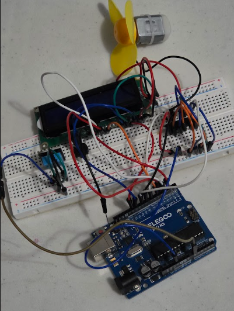

# Check-in 1 – Initial Assembly and Research

## Project Progress

I have completed the initial hardware assembly of my automatic temperature-controlled fan system. I connected the Arduino Uno R3, L293D motor driver, DC motor, 16×2 LCD display, DHT11 temperature sensor, and two potentiometers using a breadboard and jumper wires.

During the assembly process, I learned how to identify the pins on the motor driver, connect the LCD display, establish a common ground, and connect the temperature sensor to the Arduino.

The physical assembly is complete, but I still need to verify the wiring, program the Arduino, and test the functionality of the system.
v

## Scheduled Goal and plans

I have  the have completed the assembly stee. However, programming and functional testing are not in progress yet. My next priority is to test each component individually before combining everything into a single Arduino program. I made several adjustments to my original project design:Replaced the LM35 temperature sensor with a DHT11 temperature and humidity sensor because it was available in my Arduino kit. I Selected the L293D motor driver to control the DC motor. I Removed the LED indicators and audio alarm to simplify the circuit and Extended some jumper wires to accommodate the physical arrangement of the components. 
Before the final submission, I plan to ,Verify all wiring and power connections, Test the DHT11 temperature sensor using the Serial Monitor, Program and test the LCD display, Test the DC motor and L293D motor driver, Program the potentiometer to adjust the desired temperature, Develop an automatic fan speed control algorithm using PWM, Complete the circuit diagram and document the experimental results and Record a demonstration video of the completed project.

## Research and Similar Projects

During my research, I found a similar temperature-controlled fan project on Circuit Digest. This project uses an Arduino Uno, a DHT11 temperature and a sensor, a DC fan, a 16×2 LCD display, and a 2N2222 transistor. It works the same way my project does in the sense that The Arduino reads the surrounding temperature and adjusts the fan speed using pulse width modulation (PWM). The LCD displays the current temperature and fan speed. This project is different form mine in the sense that it uses a 2N2222 transistor to control the motor, my project uses an L293D motor driver. My design also includes a potentiometer that is intended to allow the user to adjust the desired temperature setting.

One commercial product that performs a similar function is the AC Infinity AIRPLATE T-Series cooling system. This product is designed to prevent electronic equipment from overheating. It uses a thermal probe to measure temperature, a digital controller to process the measurements, and electric fans to provide cooling. Users can adjust the desired temperature and fans speeds. My project uses arduino programing and manual wiring while the commercial has inetegrated sensors and controllers. 

Reference 
[AC Infinity - Commercial Temperature Controlled Fan](https://acinfinity.com/)

[Circuit Digest - Automatic Temperature Controlled Fan](https://circuitdigest.com/microcontroller-projects/automatic-temperature-controlled-fan-project)
